<div align="center">


**The personal portfolio of Utkarsh Kumar Nigam.** He's a CSE (AI) student at Parul University and an AI Intern at InternVision Technology.

[](https://utkarshkumarnigam-lab.github.io)
[](https://www.linkedin.com/in/utkarshkumarnigam/)
[](https://github.com/utkarshkumarnigam-lab)

<br>

<a href="https://utkarshkumarnigam-lab.github.io">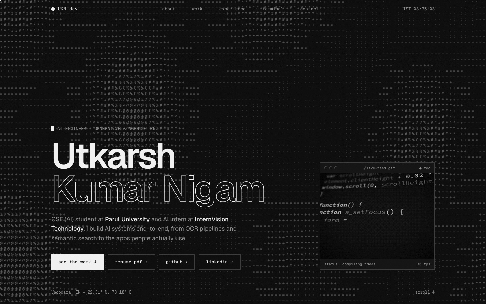</a>

</div>

<br>

The whole site is a single `index.html` in black, grey and white, with no frameworks, no build step and no dependencies. Each project shows a small live sketch of what it does instead of a static thumbnail. There's also a fake shell you can type commands into.

## Contents

- [Highlights](#highlights)
- [Screenshots](#screenshots)
- [Projects featured](#projects-featured)
- [How it's built](#how-its-built)
- [Run it locally](#run-it-locally)
- [Contact](#contact)

## Highlights

| | |
|---|---|
| **ASCII wave hero** | A field of characters (` .·:-=+*#%@`) on a canvas that ripples around your cursor. |
| **Text decode** | Headings resolve from random glyphs as they scroll into view. |
| **Live project sketches** | A case-score engine, real gradient descent, a playable runner and a looping chat, all in plain JS. |
| **Interactive terminal** | Try `help`, `whoami`, `projects`, `skills` … and `sudo hire utkarsh`. |
| **Small details** | Custom blend-mode cursor, live IST clock, scroll progress bar, film grain, hover fills. |
| **Accessible by default** | Respects `prefers-reduced-motion`, works at phone width, and animations pause when off-screen. |

## Screenshots

### About

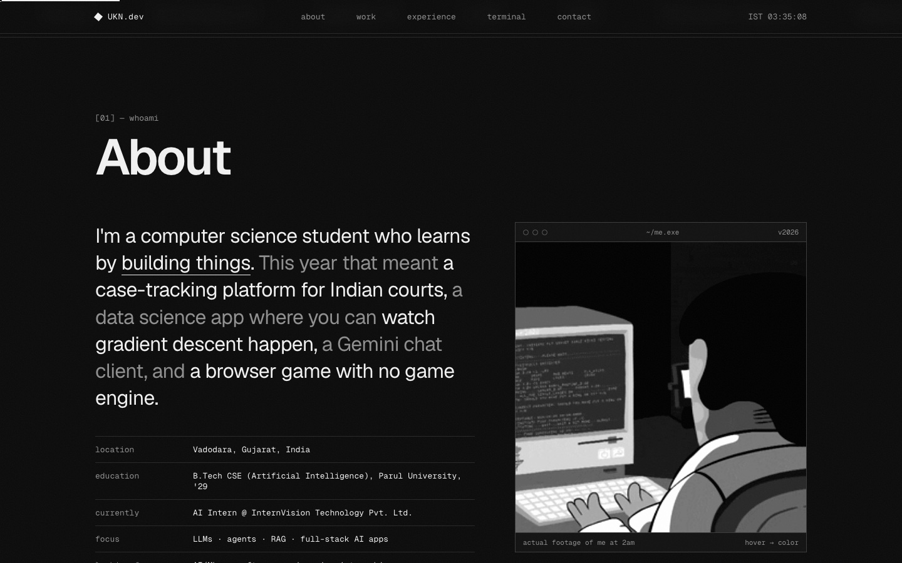

### Selected work

Each project has a live sketch next to it.

<table>
<tr>
<td width="50%">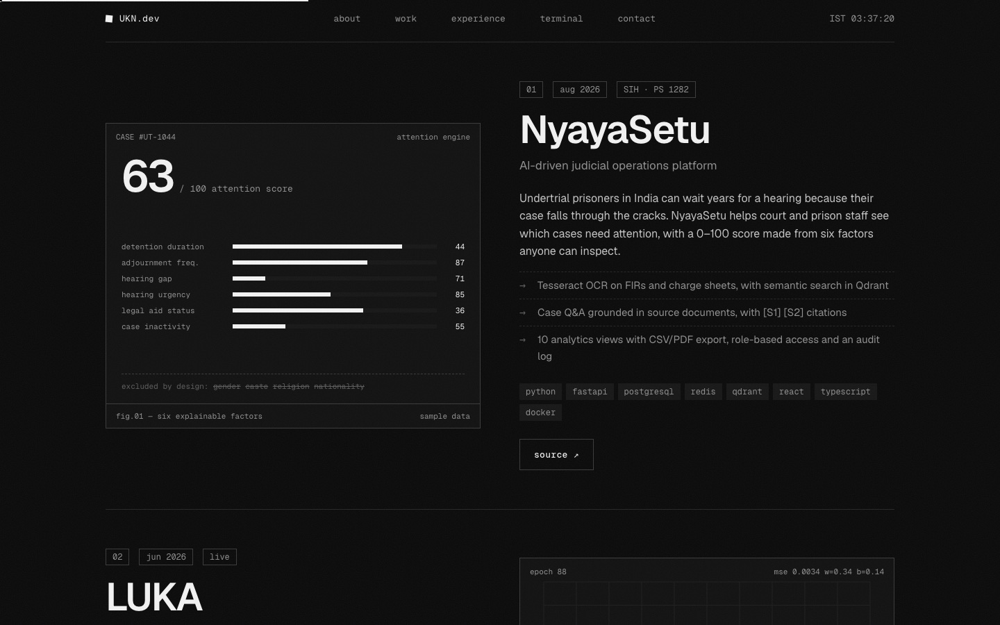<br><sub><b>NyayaSetu</b>: a 0–100 attention score built from six explainable factors, cycling through sample cases.</sub></td>
<td width="50%">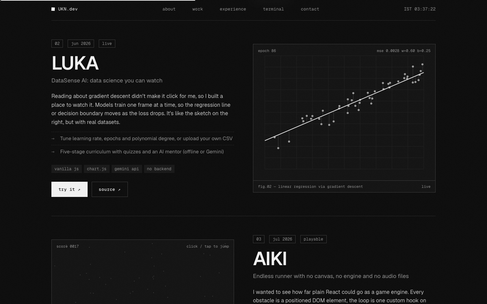<br><sub><b>LUKA</b>: real gradient descent. The line fits the points frame by frame while epoch and MSE update.</sub></td>
</tr>
<tr>
<td width="50%">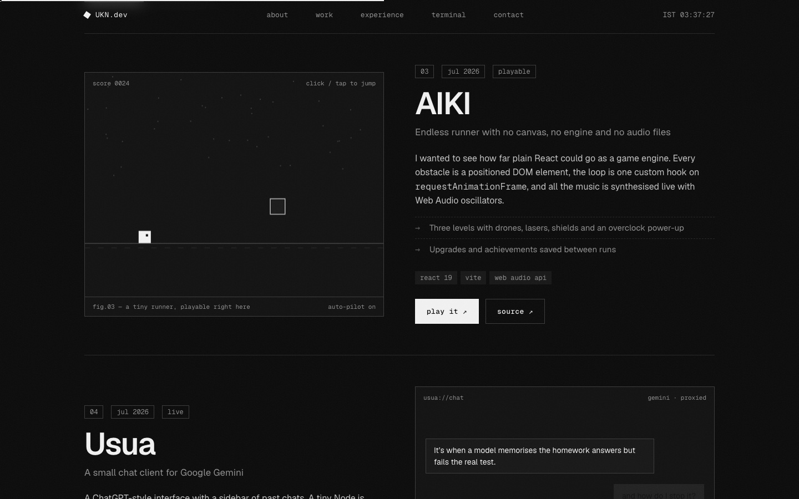<br><sub><b>AIKI</b>: a tiny runner that plays itself. Click or tap to jump, and crashing shows <code>SEGFAULT</code>.</sub></td>
<td width="50%">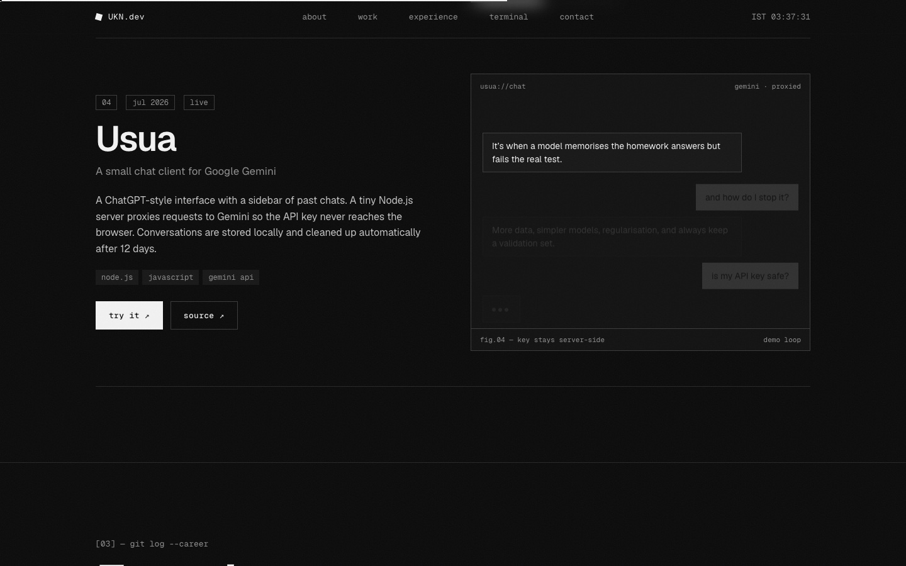<br><sub><b>Usua</b>: a looping chat that shows why the API key stays on the server.</sub></td>
</tr>
</table>

### Experience

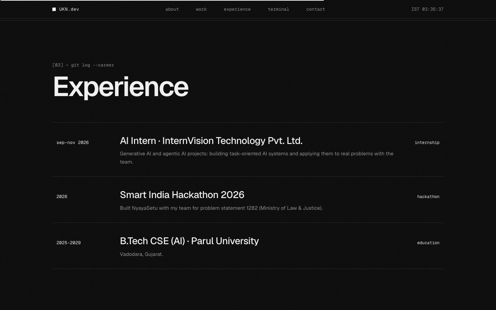

### Terminal

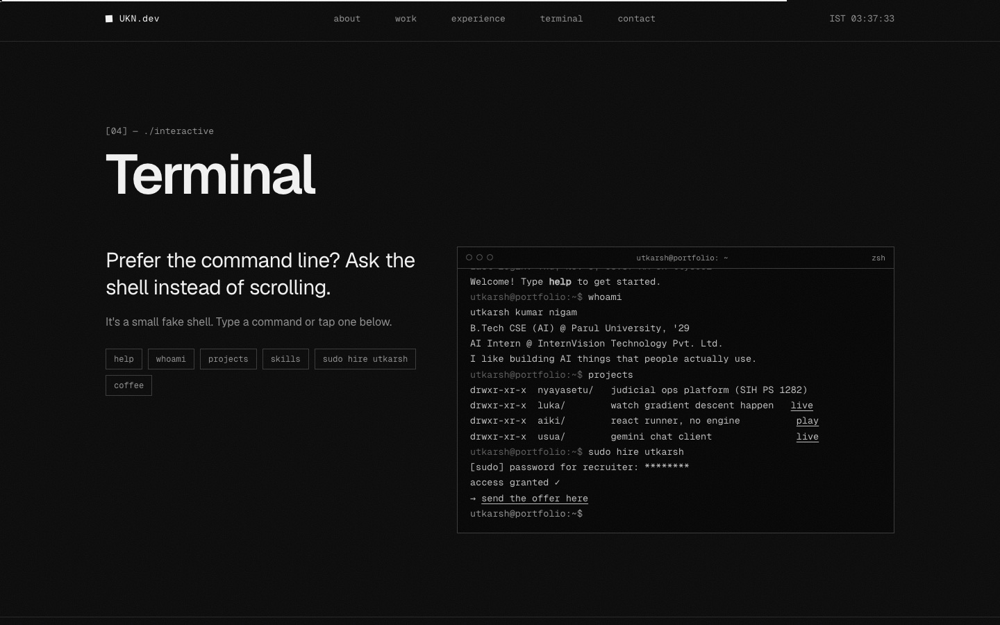

### Runtime log

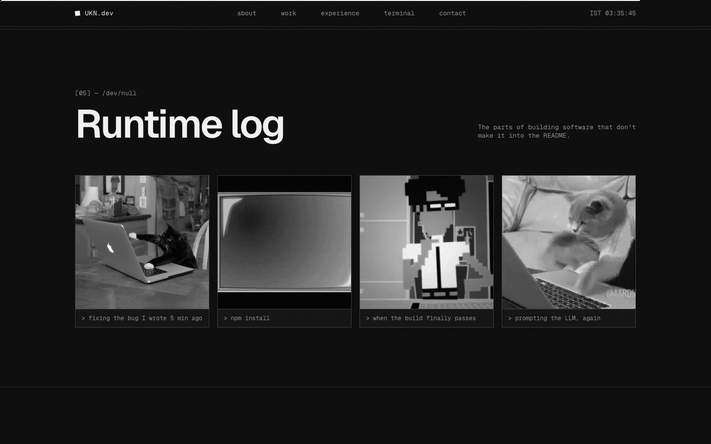

### Contact

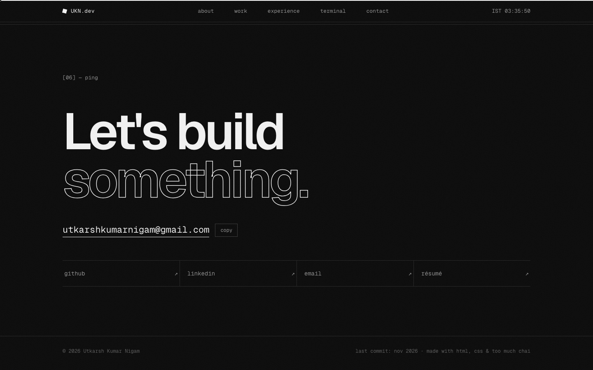

### Mobile

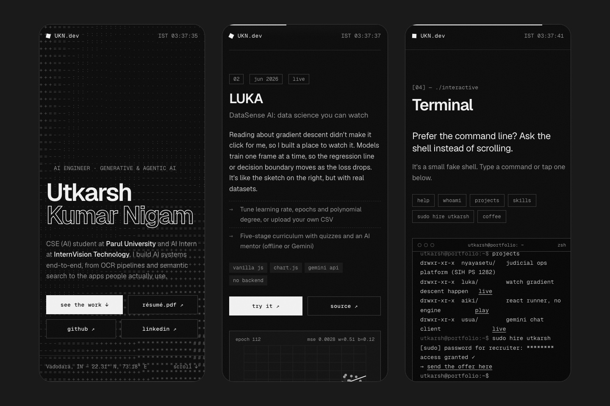

## Projects featured

| Project | What it is | Links |
|---|---|---|
| **NyayaSetu** | AI-driven judicial operations platform for SIH problem statement 1282: OCR, semantic search, explainable case scoring | [source](https://github.com/utkarshkumarnigam-lab/NyayaSetu) |
| **LUKA — DataSense AI** | A data science learning app where you can watch models train | [live](https://utkarshkumarnigam-lab.github.io/LUKA/) · [source](https://github.com/utkarshkumarnigam-lab/LUKA) |
| **AIKI** | An endless runner in React with no canvas, no engine and no audio files | [play](https://aiki-three.vercel.app) · [source](https://github.com/utkarshkumarnigam-lab/AIKI) |
| **Usua** | A Gemini chat client with a server-side key proxy | [live](https://utkarshkumarnigam-lab.github.io/Usua/) · [source](https://github.com/utkarshkumarnigam-lab/Usua) |

## How it's built

```
.
├── index.html                       # the entire site: HTML, CSS and JS
├── Utkarsh_Kumar_Nigam_Resume.pdf   # linked from the site
└── screenshots/                     # images used in this README
```

- **Stack:** plain HTML, CSS and vanilla JavaScript. No frameworks, bundlers or packages.
- **Type:** [Geist](https://vercel.com/font) and Geist Mono via Google Fonts.
- **Animations:** `<canvas>` and `requestAnimationFrame`. Each loop runs only while its element is on screen (`IntersectionObserver`), and the hero is capped at about 30 fps.
- **GIFs:** loaded from Giphy, shown in greyscale and turning to colour on hover.
- **Hosting:** GitHub Pages from the `main` branch. Every push to `main` redeploys the site.

## Run it locally

```bash
git clone https://github.com/utkarshkumarnigam-lab/utkarshkumarnigam-lab.github.io.git
cd utkarshkumarnigam-lab.github.io
python3 -m http.server 8000   # then open http://localhost:8000
```

You can also just open `index.html` in a browser.

## Contact

**Email:** [utkarshkumarnigam@gmail.com](mailto:utkarshkumarnigam@gmail.com) · **LinkedIn:** [in/utkarshkumarnigam](https://www.linkedin.com/in/utkarshkumarnigam/) · **GitHub:** [utkarshkumarnigam-lab](https://github.com/utkarshkumarnigam-lab)

<sub>© 2026 Utkarsh Kumar Nigam</sub>
